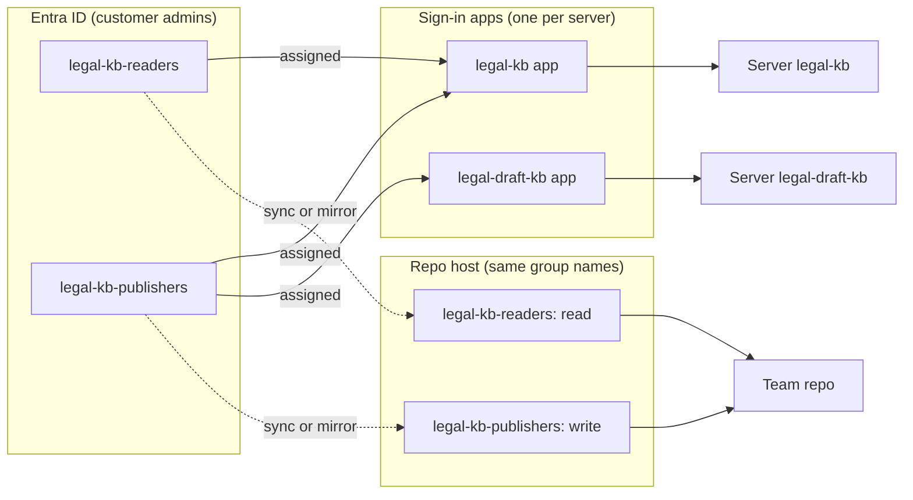

# Access model

Who may ask a team's EKS server, and who may edit its documents. Two groups
per team, used in two places: the sign-in apps and the repo host. Anyone who
can ask the server can also open the source links in its answers
([content-sources.md](content-sources.md#links-to-the-source-page)).



## Two groups per team

Same names in Entra and on the repo host.

| Group | Entra: assigned to | Repo host role | Can |
|---|---|---|---|
| `<team>-kb-readers` | main server app (`<team>-kb`) | read | ask the server, open source links |
| `<team>-kb-publishers` | main app and draft app (`<team>-draft-kb`) | write | all of the above, edit documents, ask the draft server |

In the team's `deployment.json` (keys from [add-a-team.md](add-a-team.md#who-reads-who-publishes)):

```json
"access": {"readers": "legal-kb-readers", "publishers": "legal-kb-publishers", "draftServer": true}
```

EKS does not read group claims. The sign-in app lets people in (Entra:
"Assignment required" plus the assigned groups, [entra-setup.md](entra-setup.md)),
and the repo host decides who reads and writes the source.

## One server = one access boundary

Everyone who can sign in to a server can find every document behind it.
There are no per-document permissions inside one server. When some
documents need a smaller set of readers, they go to another server.

| Case | Servers | Groups |
|---|---|---|
| One server: all Legal policies for staff who handle contracts | `legal-kb` | `legal-kb-readers`, `legal-kb-publishers` |
| Split: litigation notes only for the Legal team | `legal-kb` and `legal-internal-kb` (its own team repo, `--team legal-internal`) | `legal-internal-kb-readers`, `legal-internal-kb-publishers`, on its own app |
| Draft: publishers check an edit before it merges | `legal-kb` and `legal-draft-kb` (same repo, `draft` branch) | publishers only on the draft app |

Rules:

- Put a document only where every reader of that server may see it.
- Different readers: a different server, team repo and sign-in app.
- A draft server has its own app, so readers' tokens do not open it.
- The repo gives the same split: readers read the repo, publishers write it.

## Repo host: how Entra groups reach repo roles

| Host | How the group gets repo rights | Plan needed | Roles to give |
|---|---|---|---|
| Azure DevOps | Add the Entra groups directly to project groups or repo security. No sync step. | Org connected to Entra. Readers need **Basic** access level to see code in private projects (Stakeholder sees no code). Basic is free for 5 users, then paid. | readers: project **Readers**; publishers: **Contributors** |
| GitHub | Team sync links a GitHub team to an Entra group. With Enterprise Managed Users (EMU), SCIM groups link to teams instead. Repo rights are still set on the team in GitHub. | **GitHub Enterprise Cloud** with SAML SSO (team sync), or EMU. Free and Team plans: no sync. | readers team: **Read**; publishers team: **Write** |
| GitLab | SAML group links map an Entra group to a GitLab group with a role. SCIM adds and removes users. | **Premium** or Ultimate. GitLab.com: group SAML SSO. Self-managed: instance SAML with group sync set up by the admin. | readers: **Reporter**; publishers: **Developer** |

Notes from the vendor docs:

- Azure DevOps: members of the Entra group inherit the Azure DevOps group's
  rights ([add an Entra group](https://learn.microsoft.com/en-us/azure/devops/organizations/security/add-ad-aad-built-in-security-groups?view=azure-devops),
  [access levels](https://learn.microsoft.com/en-us/azure/devops/organizations/security/access-levels?view=azure-devops),
  [Stakeholder and code](https://learn.microsoft.com/en-us/azure/devops/repos/tfvc/set-tfvc-repository-permissions?view=azure-devops)).
  A group rule can give the readers group Basic access
  ([group rules](https://learn.microsoft.com/en-us/azure/devops/organizations/accounts/assign-access-levels-by-group-membership)).
- GitHub: the team must exist first; sync adds only people who are already
  org members and have signed in with SAML SSO once, and checks the IdP at
  least hourly. A team is limited to 5,000 members for sync, and parent teams
  cannot sync. Enabling it needs an Entra Global or Privileged Role
  administrator
  ([sync a team](https://docs.github.com/en/organizations/organizing-members-into-teams/synchronizing-a-team-with-an-identity-provider-group),
  [enable team sync](https://docs.github.com/en/enterprise-cloud@latest/organizations/managing-saml-single-sign-on-for-your-organization/managing-team-synchronization-for-your-organization),
  [EMU groups](https://docs.github.com/en/enterprise-cloud@latest/admin/managing-iam/provisioning-user-accounts-with-scim/managing-team-memberships-with-identity-provider-groups)).
- GitLab: group sync does not create groups; make the GitLab group first.
  The SAML group name must match what Entra sends, which is often the group's
  object id, not its display name. A user's role updates when they sign in,
  and people not in a mapped group are removed
  ([SAML group sync](https://docs.gitlab.com/user/group/saml_sso/group_sync/),
  [GitLab.com SAML SSO](https://docs.gitlab.com/user/group/saml_sso/),
  [SCIM for GitLab.com](https://docs.gitlab.com/user/group/saml_sso/scim_setup/)).

### When the host cannot sync

GitHub Free or Team, GitLab Free, or no SAML on the host: mirror by hand.
Make a team (GitHub) or group (GitLab) with the same name, give it the role
above, and add the same people as in Entra. Check it when people join or
leave, for example in the team's access review. EKS sign-in still follows
Entra; only source links and edits depend on the mirror.

## Who does what

| Step | EKS (`add-team.sh`, setup page) | Customer admins |
|---|---|---|
| Group names | Suggests `<team>-kb-readers` and `<team>-kb-publishers`; prints a checklist | Create both groups in Entra |
| Sign-in apps | Prints which group goes on which app; `identity/entra/setup_entra_app.sh` can make an app | Entra admin makes the apps, sets "Assignment required", assigns the groups |
| Repo roles | Prints which role each group gets on the configured host (`templates/host-setup/<host>.md`). Grants nothing: EKS never calls the git host | Repo host admin sets up sync (or a mirror) and gives the roles; Azure DevOps: connects the org to the Entra tenant |
| Server | Deploys the server and checks the token is for its own app | Nothing |

EKS never creates groups. It changes the repo host only on Azure DevOps with
Entra sign-in: the two group grants and the Basic group rule above. The
checklist is a suggestion.
