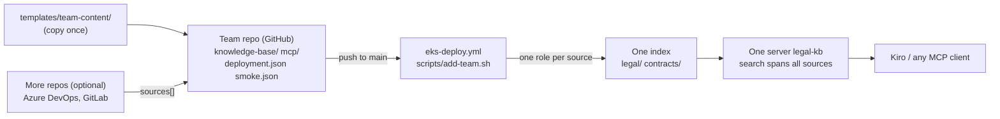

# Add a team

Each team (legal, procurement, ...) gets its own EKS stack: its own server
name, documents, instructions, prompts and sign-in, in its own AWS account or
under its own prefix in a shared one. The product code stays in this repo. The
team's content lives in the team's own repo.



## Get started: one command

EKS never creates repos or projects and never calls your git host's API
(Azure DevOps, GitHub, GitLab). The team copies `templates/team-content/` into
a repo it already has ([its README](../templates/team-content/README.md)),
then points EKS at it. EKS does the AWS side only.

The setup page's **Get started** tab ([team-setup.md](team-setup.md)) asks
where the documents live (GitHub, Azure DevOps, GitLab or a local folder), the
sign-in, the team name and the AWS profile and region. It prints one command,
the team `deployment.json`, and the steps to do on the git host. Run the
command from a checkout of this repo:

```bash
AWS_PROFILE=eks-demo scripts/add-team.sh --team legal \
  --content https://dev.azure.com/contoso/EKS-Legal/_git/legal-docs \
  --ado-org-id <instanceId> \
  --region us-east-1 --auth entra --entra-tenant-id <id> --entra-client-id <id>
```

A repo URL is cloned with plain git and your own git login. The host comes
from the URL alone:

| Step | Azure DevOps (`dev.azure.com`) | GitHub (`github.com`) | GitLab (a `gitlab` host) | Local folder |
|---|---|---|---|---|
| Input | `--ado-org-id` (or `azureDevOps.orgId`): `instanceId` of `<org>/_apis/connectionData`, opened in a signed-in browser | `--github-repo-ids owner@ID/name@ID` (optional; newer repos need it) | none | none |
| AWS trust | stack role for service connection `aws-kb-sync` of the project only | `<prefix>-github-deploy` role (`cicd/github/deploy-role.yaml`), trusted by the content role | none yet | none |
| Deploy | deploy, load, `mcp/`, smoke test, Kiro entry | same | same | same |
| Files written | team `deployment.json`; `kb-pipelines/` and `azure-pipelines.yml` in `.eks/teams/<team>-ado/` | team `deployment.json` | team `deployment.json` | none |
| Steps you do on the host | [azure-devops.md](../templates/host-setup/azure-devops.md): extension, `kb-pipelines` repo, service connection (OIDC, the printed role), pipeline, checks, branch policies, group rights | [github.md](../templates/host-setup/github.md): `eks-deploy.yml` variables, `EKS_REPO_TOKEN`, group rights | [gitlab.md](../templates/host-setup/gitlab.md): group rights | [local.md](../templates/host-setup/local.md) |

The steps are one text, `templates/host-setup/<host>.md`: the setup page shows
it, and the command prints it again with the real values (role ARN, EKS
release). The command never pushes: copy the team `deployment.json` it wrote
(`.eks/teams/<team>/deployment.json`) into your repo and commit it.

Azure DevOps: instead of the manual steps, run `platform/ado-setup.sh`: one
command in AWS CloudShell, one on your laptop with your own PAT
([ado-setup.md](ado-setup.md)). Its `check` is a rights test you can send
before the install.

Not the identity, AWS or Azure DevOps admin yourself? Choose **IT does it**
for that part: the page writes a request pack for your IT ticket and takes
the values IT sends back ([it-request-packs.md](it-request-packs.md);
CLI: `--request-pack <dir>`).

`--host`, `--repo`, `--new-repo`, `--org`, `--project` and
`--creator-can-approve` are gone: the command stops with one line that points
to the template and `--content`. `scripts/uninstall.sh` also deletes the
`<prefix>-github-deploy` stack.

## 1. Make the team repo (5 min)

Copy `templates/team-content/` into your repo
([its README](../templates/team-content/README.md) has the steps per host). Then edit:

| File | What to change |
|---|---|
| `knowledge-base/*.md` | Your documents. Each needs front matter: title, category, owner, tags. |
| `mcp/instructions.md` | What the server holds and how to answer. Assistants read it on connect. |
| `mcp/prompts/*.md` | Reusable prompts, or delete the example. |
| `deployment.json` | Region, sign-in (`gatewayAuth`, `identity`), account. Any key of `deployment.example.json` works. |
| `smoke.json` | Questions your documents must answer, and some they must not. |

Names come from the team name unless `deployment.json` sets them:
prefix `eks-<team>`, source id `<team>`, server name and Kiro entry `<team>-kb`.

### More than one repo

One team may keep documents in several repos, on any git provider. List them
under `sources` in the team repo's `deployment.json`; the first is the team
repo itself (it holds `mcp/` and `smoke.json`):

```json
"sources": [
  {"id": "legal", "provider": "github", "path": "knowledge-base"},
  {"id": "contracts", "provider": "azure-devops",
   "repo": "https://dev.azure.com/acme/Legal/_git/contracts", "branch": "main", "path": "docs"}
]
```

| Key | Meaning |
|---|---|
| `id` | Namespace, lowercase. Document ids start with it: `contracts/x.md`. |
| `provider` | `github`, `azure-devops`, `gitlab` or `local`. Sets the link format; `local` turns links off. |
| `repo` | Empty: the team repo. A git URL: cloned (shallow). A folder: relative to the team repo. |
| `branch` | Branch to clone. Default: the repo's default branch. |
| `path` | Markdown folder in the repo. Default `knowledge-base/` when there is one. |
| `linkTo` | `commit`: search results link the synced commit. Default: the newest page on the branch ([links](content-sources.md#links-to-the-source-page)). |

All sources go into one index behind one server, and search spans them all.
The tool names do not change. Each source is loaded with its own CI role,
`<ciContentRole>-<id>` (the first keeps `<ciContentRole>`), which may write
only that source's namespace. The single `"source": {"id": ...}` form still
works.

Or fill in the setup page instead of editing the file by hand:
[team-setup.md](team-setup.md) (Cloudscape, runs on your computer).

### Who reads, who publishes

```json
"access": {"readers": "legal-kb-readers", "publishers": "legal-kb-publishers", "draftServer": true}
```

| Key | Meaning |
|---|---|
| `readers` | Group that may ask the server. |
| `publishers` | Group that edits the documents. May ask the server and the draft server. |
| `draftServer` | `true`: the team also has a draft server (below). |
| `draftIdentity` | Sign-in of the draft server, same shape as `identity`: its own app. Needed with `gatewayAuth` `oidc`. |

The sign-in app enforces this, not EKS: the Entra admin assigns readers and
publishers to the `legal-kb` app and publishers only to the `legal-draft-kb`
app ([entra-setup.md](entra-setup.md), which also has the IAM Identity
Center path). Use the same two groups on the repo host: readers read,
publishers write, so every reader can open the source links. One server is
one access boundary: documents for other readers go to another server. The
whole model, and how each repo host takes Entra groups:
[access-model.md](access-model.md).

`add-team.sh` and the setup page print a checklist: groups to create, which
app gets which group, and which repo role each group gets on each host in
`sources`. It is a suggestion; nothing creates groups or grants rights. The
host steps above say where each group goes.

### Draft server

Publishers see an edit before it is merged. The draft server is a second
stack from the same sources, read from a draft branch:

| | Main server | Draft server |
|---|---|---|
| Command | `add-team.sh --team legal ...` | `add-team.sh --team legal ... --draft` |
| Prefix | `eks-legal` | `eks-legal-draft` |
| Server name | `legal-kb` | `legal-draft-kb` |
| Branch of each source | `branch` | `draftBranch` (default `draft`) |
| Sign-in | `identity` | `access.draftIdentity` |
| Who | readers + publishers | publishers |

The config (account, roles, sign-in) always comes from `deployment.json` on
the main branch; only documents, `mcp/` and `smoke.json` come from the draft
branch, so a draft push cannot change who may sign in. A team repo given as a
folder must have the draft branch in git (`origin/draft` or `draft`; in CI,
check out with `fetch-depth: 0`). A source that has no draft branch sets
`"draftBranch": "main"`. Run it from its own checkout: one `deployment.json`
per checkout.

`"proposals": true` in `access` adds the `propose_change` tool to the draft
server only: a writer asks their agent for a change, and the server opens a
pull request into the draft branch for a publisher to merge.
[propose-change.md](propose-change.md).

## 2. Deploy it (10-15 min the first time)

From a checkout of this repo, signed in to the target account:

```bash
scripts/add-team.sh --team legal --content ../legal-content
scripts/add-team.sh --team legal --content https://github.com/acme/legal-content.git \
  --region eu-west-1 --auth entra --entra-tenant-id <id> --entra-client-id <id>
```

It writes `deployment.json` from the team's file, then runs the same steps as
`scripts/install.sh`: deploy, load `knowledge-base/`, publish `mcp/`, smoke
test with `smoke.json`, print the Kiro `mcp.json` entry. Every install flag
works (`--prefix`, `--account`, `--auth`, ... see [install.md](install.md#flags)).
One checkout holds one `deployment.json`: use one checkout per team.

## 3. Let pushes deploy it

`.github/workflows/eks-deploy.yml` in the team repo runs the same command on
every push to main that changes documents, `mcp/`, `deployment.json` or
`smoke.json`. Set its variables once (listed at the top of the file). The
deploy role it assumes needs CDK deploy rights in the target account; the
stack's content role `<prefix>-ci-content` trusts it.

## The demo: a fake legal team

`examples/team-legal-demo/` is a filled-in copy of the template with fake legal
documents. It has two sources: `legal` (this folder) and `contracts`
(`examples/team-legal-demo-contracts/`, a folder standing in for an Azure
DevOps repo). `.github/workflows/deploy-team-demo.yml` deploys it as
`ekb-legal-demo` to our solution account (ap-south-1) with
`scripts/add-team.sh`, on every push to main that changes it. Its smoke test
checks:

- `initialize` returns server name `legal-kb` and the legal instructions;
- `list_documents` holds both namespaces, `contracts` and `legal`;
- one question is answered from `legal/`, one from `contracts/`;
- 4 other questions (1 trademark, 2 analytics, 1 off topic) get no answer.

The same workflow deploys its draft server, `ekb-legal-demo-draft`
(`legal-draft-kb`), with `--draft` from the branch
`crew/mate/legal-demo-draft`. That branch adds one document,
`legal/trademark-register.md`. Its `smoke.json` asks the trademark question
and expects that document. So the trademark question is answered by
`legal-draft-kb` and not by `legal-kb`. The demo signs in with IAM, so its
`access` groups are labels only.

Shortcut: its content role names follow the pattern our factory's deploy
role may assume (docs/factory.md), not the default `<prefix>-ci-content`.
A real team uses its own deploy role.

## Remove a team

From the checkout that deployed it: `scripts/uninstall.sh`. It destroys the
stack and lists anything still named after the prefix. A draft server is its
own stack: run it in the draft checkout too.
