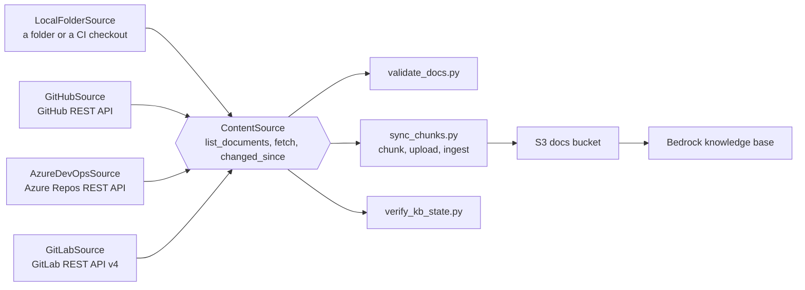

# Content sources: where documents come from

The sync pipeline (validate, chunk, upload, ingest, verify) reads documents
through one interface, `sync/content_sources.py`. Each content host is an
adapter. Decision: [ADR 0001](decisions/0001-identity-and-source-agnostic-core.md).

## The interface

| Method | Returns |
|---|---|
| `list_documents()` | Sorted relative paths of the `.md` documents |
| `fetch(doc)` | The document's text |
| `changed_since(ref)` | Documents changed since `ref`: a commit (GitHub, Azure DevOps) or an ISO time (local) |

`sync_chunks.py` still compares chunk hashes with its manifest, so every run
is correct from `list_documents` and `fetch` alone. `changed_since` tells you
what moved. Documents are keyed by file name, so two files with the same name
in different subfolders clash (as before).

## Adapters

| `--source` | Adapter | Flags | Token |
|---|---|---|---|
| `local` (default) | `LocalFolderSource` | `--docs-dir` | none |
| `github` | `GitHubSource` | `--repo owner/name --folder <dir> --ref <branch or sha>` | env `GITHUB_TOKEN` |
| `azure-devops` | `AzureDevOpsSource` | `--org-url https://dev.azure.com/<org> --project 
 --repo <r> --folder <dir> --ref <branch>` | env `AZURE_DEVOPS_TOKEN` (PAT) or `SYSTEM_ACCESSTOKEN` (pipeline) |
| `gitlab` | `GitLabSource` | `--repo group/project --folder <dir> --ref <branch>`; `--org-url https://<host>` for self-managed GitLab (default gitlab.com) | env `GITLAB_TOKEN` (`read_repository`) |

The same flags work on `validate_docs.py`, `sync_chunks.py` and
`verify_kb_state.py`. Tokens are read from the environment and never logged.

Where each is used:

- The deploy workflow's content load (`infra/load_content.py`) uses
  `LocalFolderSource` on `sample-content/knowledge-base`.
- The Azure DevOps pipeline (`cicd/azure-devops/`) checks the content
  repository out and runs the scripts with `--docs-dir`, so it uses
  `LocalFolderSource` on the checkout. `AzureDevOpsSource` reads the same
  repository without a checkout.
- `cicd/github/kb-sync.yml` is an example workflow for a customer's docs
  repository on GitHub. It uses `GitHubSource`. It is not run here.

## In deployment.json: the `sources` list

A team's `deployment.json` lists its content repositories in `sources`
([add-a-team.md](add-a-team.md#more-than-one-repo); the setup page in
[team-setup.md](team-setup.md) writes it). `content_sources.from_config(entry, root)`
turns one entry into its adapter:

| `repo` | Adapter |
|---|---|
| empty or a folder | `LocalFolderSource` under `root` (the team repo checkout) |
| `https://github.com/<owner>/<name>.git` | `GitHubSource` |
| `https://<gitlab host>/<group>/<project>.git` | `GitLabSource` (self-managed hosts too) |
| `https://dev.azure.com/<org>/<project>/_git/<repo>` | `AzureDevOpsSource` |

`path` is the folder, `branch` the ref (default `main`). Tokens never go in
this file.

## Links to the source page

Each `search_knowledge_base` hit and each `retrieve_document` result carries a
`source_url`: the page in the repo, with the hit's lines. The tool result also
holds it as an MCP `resource_link` item, so a client can show it as a link.

| Provider | Link |
|---|---|
| GitHub | `https://github.com/<owner>/<repo>/blob/<branch>/<path>#L<a>-L<b>` |
| GitLab | `https://<host>/<group>/<repo>/-/blob/<branch>/<path>#L<a>-<b>` |
| Azure DevOps | `https://dev.azure.com/<org>/<project>/_git/<repo>?path=/<path>&version=GB<branch>&line=<a>&lineEnd=<b>` |

- Default: the newest page on the branch. Content is live by design.
- `"linkTo": "commit"` on a `deployment.json` source (or `--link-to commit` on
  `sync_chunks.py`) links the synced commit instead (`GC<sha>` on Azure DevOps).
- The sync reads provider, repo, branch and commit from the git checkout the
  docs folder is in (`sync/source_links.py`); a detached CI checkout takes the
  branch from the CI variables. The API adapters know them already.
- A plain folder (not a git checkout of GitHub, GitLab or Azure DevOps), or
  `"provider": "local"`, gets no link: `source_url` is left out.
- A self-hosted GitLab whose host name does not say `gitlab`: set
  `"provider": "gitlab"` on the source.
- Private repos: the link opens only for people who can read the repo.
- Where the links live: each sync writes `knowledge-base/<id>/_source-links.json`
  (object key to URL) beside the whole documents. Bedrock does not ingest that
  prefix, so rewriting it embeds nothing. The server reads it and keeps it for
  60 seconds.
- The chunk hash is the section text only. A line added at the top of a doc
  embeds the one section it lands in; the other sections keep their vectors,
  and their links move to the new lines on the same sync.

## Add a source

1. Write a class with `name`, `list_documents`, `fetch` and `changed_since`
   in `sync/content_sources.py`.
2. Add it to `from_args` and the `--source` choices.
3. Add tests with a fake HTTP getter, like `tests/test_content_sources.py`.
