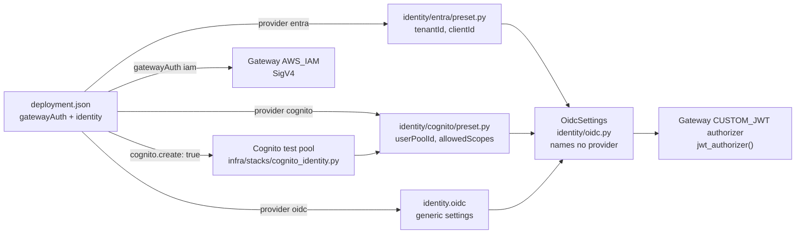

# Sign-in: plug in any OIDC provider

Any MCP client may call (Kiro, Claude Code, VS Code, Cursor, ...). The gateway
does not ask which app got the token. It asks whether the token was issued
FOR THIS SERVER: the audience (`aud`, Entra and most providers) or this
server's scope (Cognito, whose access tokens have no `aud`). A valid token for
another app in the same tenant or pool is refused with 403.

The MCP gateway (AgentCore Gateway) checks every caller. It has two modes,
set by `gatewayAuth` in `deployment.json`:

| `gatewayAuth` | Who can call | Settings |
|---|---|---|
| `"iam"` | AWS principals with `bedrock-agentcore:InvokeGateway` (SigV4) | none |
| `"oidc"` | Holders of a token from your OIDC provider | `identity` section |
| absent, no `identity` | Nobody: no gateway is made | |

Decision: [ADR 0001](decisions/0001-identity-and-source-agnostic-core.md).
Code: `identity/oidc.py` (generic settings), `identity/config.py` (reads
`deployment.json`), `identity/<provider>/preset.py` (presets),
`infra/stacks/kb_mcp_stack.py` `jwt_authorizer()` (builds the authorizer).

## How it fits



## The generic settings

Every preset fills in these, and the gateway is built from these only.

| Key in `identity.oidc` | Meaning | Gateway setting |
|---|---|---|
| `discoveryUrl` | The provider's `/.well-known/openid-configuration` URL, https | `DiscoveryUrl` |
| `allowedAudiences` | Allowed `aud` values: this server | `AllowedAudience` |
| `allowedScopes` | Scopes the token must hold: this server's scope | `AllowedScopes` (also advertised to clients) |
| `allowedClients` | Optional pin on calling apps; empty or absent = any client | `AllowedClients` when `clientClaim` is `client_id`; else an EQUALS claim check |
| `clientClaim` | Which claim names the app: `client_id` (default), `azp`, `cid`, ... | |
| `requiredClaims` | List of `name=value`; each claim must equal the value | EQUALS claim checks |

Set `allowedAudiences` or `allowedScopes` (or both). `allowedClients` is
only an extra pin. A `clientClaim` other than `client_id` takes one allowed
client.

Entra sets no scopes: Entra writes short scopes (`scp=kb.read`), and a scope
setting makes every Entra token fail. Entra's gate is `aud` plus `tid`.

## Which apps may call

`allowedClients` (Cognito: `clientIds`) is optional. Empty or absent (the
default) lets in any MCP client. A list lets in only those client IDs.

This is a soft check. A public client ID is not a secret: anyone can copy it
into another app. Real control over approved apps sits with the company:

| Control | Where | Stops |
|---|---|---|
| `allowedClients` | this gateway | honest apps with a different client ID (soft) |
| Group assignment (assignment required) | Entra app | people outside the group |
| Conditional Access: managed or compliant device | Entra | sign-in from unmanaged devices |
| Device management (Intune or similar) | company devices | apps the company has not approved |

Checking the calling app itself (approved clients only) is long-term work:
issue #54.

## Presets

| Provider | Gate | Optional client pin |
|---|---|---|
| Entra ID | `aud` = `clientId`, `tid` = tenant | `entra.allowedClients` (one, on `azp`) |
| Amazon Cognito | scope `cognito.allowedScopes` (e.g. `<prefix>-api/kb.read`), `token_use=access` | `cognito.clientIds` |
| Cognito made by the stack | scope `<prefix>-api/kb.read`, `token_use=access` | none |

| Provider | `identity.provider` | You give | Client claim | Required claims |
|---|---|---|---|---|
| Entra ID | `entra` | `entra.tenantId`, `entra.clientId` | `azp` | `tid=<tenant>` |
| Amazon Cognito | `cognito` | `cognito.userPoolId`, `cognito.allowedScopes` | `client_id` | `token_use=access` |
| Cognito made by the stack | `cognito` | `cognito.create: true` | `client_id` | `token_use=access` |
| Any other | `oidc` | the generic keys above | your choice | your choice |
| AWS IAM | (`gatewayAuth: "iam"`) | nothing | | |

Entra example:

```json
"gatewayAuth": "oidc",
"identity": {
  "provider": "entra",
  "entra": {"tenantId": "<tenant id>", "clientId": "<app client id>"}
}
```

`identity/entra/setup_entra_app.sh` creates the Entra app and prints the ids.
The admin's steps in the portal, groups and a draft app:
[entra-setup.md](entra-setup.md).

## Okta (generic example)

Okta access tokens name the app in `cid` and use audience `api://default`
for the default authorization server.

```json
"gatewayAuth": "oidc",
"identity": {
  "provider": "oidc",
  "oidc": {
    "discoveryUrl": "https://<your-org>.okta.com/oauth2/default/.well-known/openid-configuration",
    "allowedAudiences": ["api://default"],
    "allowedClients": ["<okta app client id>"],
    "clientClaim": "cid"
  }
}
```

Any other provider works the same way: find its discovery URL, the claim
that names the app, and any claim that pins your organization.

## Cognito test pool for the factory

`"identity": {"provider": "cognito", "cognito": {"create": true}}` makes the
stack create a user pool with two resource servers: `<prefix>-api` (scope
`kb.read`, this server) and `<prefix>-other-api` (scope `read`, "another
app"). The gateway allows any token with `<prefix>-api/kb.read`; there is no
client list. Two machine-to-machine apps (client credentials, with a secret):
`test` has this server's scope, `other` only the other app's scope, to show a
refusal. Outputs: `CognitoUserPoolId`, `CognitoTestClientId`,
`CognitoOtherClientId`, `CognitoTokenUrl`, `CognitoScope`, `CognitoOtherScope`. Secrets are not outputs; read one with
`aws cognito-idp describe-user-pool-client --user-pool-id <id> --client-id <id>`.

Get a token without a browser:

```bash
curl -s -u "<client id>:<client secret>" -d grant_type=client_credentials \
  -d scope="<CognitoScope>" "<CognitoTokenUrl>"
```

`deploy/ekb-oidc-test.json` uses this. The `deploy-main` workflow deploys it
as stack `ekb-oidc-test-stack` (job `deploy-oidc-test`), loads the sample
content, and runs `infra/signin_smoke_test.py`: the `test` client must get
search results through the gateway, the `other` client must get HTTP 401 or
403. Results show as check-run notices (or errors).

It also makes the shared public app `kiro` (no secret, authorization code +
PKCE, scopes `openid email profile <prefix>-api/kb.read`). Every MCP client
uses this one client id. Callbacks (Cognito matches them exactly):

| MCP client | Callback |
|---|---|
| Kiro | `http://localhost:7778/oauth/callback` |
| Claude Code | `http://localhost:7779/callback` (`--callback-port 7779`) |
| VS Code | `https://vscode.dev/redirect` |

A second public app `second` (callback `http://localhost:7779/callback`,
output `CognitoSecondClientId`) exists only to prove that any client with the
scope is let in. The stack also makes the secret
`ekb/demo/<prefix>/demo-user` with the demo user's name (`demo@example.com`)
and a generated password. `infra/kiro_signin_test.py` (same job) creates the
demo user, sets that password as permanent on every deploy (sign in with it
as is; a changed password goes back to the secret's value), checks the demo
user signs in with it, follows the metadata chain Kiro
follows, signs a CI-only user in through the Cognito login page with PKCE
(with the `kiro` app, then with the `second` app), and calls the gateway with
each token. A user token without this server's scope (AdminInitiateAuth) must
get 401 or 403. It prints the Kiro entry and the secret ARN
as notices, never the password. Outputs added: `CognitoKiroClientId`,
`CognitoKiroScopes`, `CognitoKiroRedirectUri`, `CognitoLoginBaseUrl`,
`DemoUserSecretArn`, `DemoUsername`.

Shortcut: its CI role has a fixed name (`ciContentRole.roleName`), because our
factory's GitHub deploy role may only assume roles with one name pattern.

## Old configs

A top-level `"entra": {"tenantId", "clientId", "debugErrors"}` section still
works. It is read as `identity.provider` `entra` and prints a deprecation
note. Move it into `identity` when you next edit the file. The gateway
settings are the same either way (snapshot test in
`tests/test_gateway_auth.py`).

## Kiro

`clients/kiro/make_mcp_config.py` prints a Kiro entry for `iam`, for the
Entra preset, and for the stack's own Cognito pool (`cognito.create`). For the
Cognito pool it also prints a Claude Code command and a VS Code entry, with
the same client id. Other OIDC providers have no entry yet.

The Cognito entry needs nothing but Kiro: a remote `url` with an `oauth` block.

```json
"ekb-oidc-test": {
  "url": "<GatewayUrl>",
  "oauthScopes": ["openid", "email", "profile", "ekb-oidc-test-api/kb.read"],
  "oauth": {
    "clientId": "<CognitoKiroClientId>",
    "redirectUri": "http://localhost:7778/oauth/callback",
    "oauthScopes": ["openid", "email", "profile", "ekb-oidc-test-api/kb.read"]
  },
  "disabled": false
}
```

How it signs in: the gateway answers 401 with `resource_metadata`; its
protected-resource metadata names the Cognito issuer; Kiro reads Cognito's
OIDC metadata and opens the Cognito login page. `clientId` skips dynamic
client registration, which Cognito does not offer. `redirectUri` is pinned
because Cognito matches callbacks exactly. The scopes are set in both places
because Kiro versions differ in which one wins, and Kiro's default set
includes `offline_access`, which Cognito refuses.

## Claude Code and VS Code

Same server, same client id (`CognitoKiroClientId`):

```bash
claude mcp add --transport http --client-id <CognitoKiroClientId> \
  --callback-port 7779 ekb-oidc-test <GatewayUrl>
```

Then `/mcp` in Claude Code, pick the server, Authenticate. The gateway
advertises its scope, so Claude Code asks Cognito for it.

VS Code, in `.vscode/mcp.json`:

```json
{"servers": {"ekb-oidc-test": {"type": "http", "url": "<GatewayUrl>"}}}
```

VS Code finds no client registration and asks for a client id: paste
`<CognitoKiroClientId>`.
