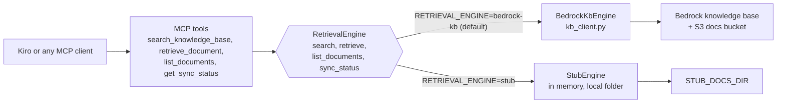

# Retrieval engines: what answers the search

The MCP server (`mcp_server/server.py`) does not call a search backend
directly. It calls a retrieval engine through one interface,
`mcp_server/engines.py`. Decision: [ADR 0001](decisions/0001-identity-and-source-agnostic-core.md).



## The interface

| Method | Returns | Used by tool |
|---|---|---|
| `search(query, k, document_id=None)` | ranked `Passage` list (`kb_client.Passage`) | `search_knowledge_base` |
| `retrieve(doc_id)` | one document: `document_id`, `s3_uri`, `metadata`, `content`, `size_bytes`, `last_modified`, `truncated` | `retrieve_document` |
| `list_documents()` | document inventory | `list_documents` |
| `sync_status()` | ingestion freshness | `get_sync_status` |

The server turns passages into the `search_knowledge_base` result, so every
engine gives the same output shape.

## The tool contract

[`contract/tools.v1.json`](../contract/tools.v1.json) is the contract, version
`1`: each tool's name, input schema and output schema, plus the name form
(`<tool>` on local stdio, `<target>___<tool>` through the gateway, target `kb`,
so `kb___search_knowledge_base`). `get_sync_status` returns `contract_version`.

The rule is add-only. A new field, input or tool is fine. Removing, renaming or
retyping a field, or making an input required, is a new contract version.
`tests/test_contract.py` checks:

- every tool's output, on the stub engine and on a faked Bedrock engine, against
  its output schema (an unlisted field fails, so add it to the file);
- the input schemas against `tools/list`;
- the file against the copy on main: a removed or renamed field fails.

`tests/test_engines.py` also compares `tools/list` byte for byte with
`tests/fixtures/tools_list.json`, descriptions included. Change that file only
on purpose.

Descriptions are neutral. The search tool adds the team's own line from config:
`serverName` (`MCP_SERVER_NAME`), then the first paragraph and the `owner` of the
team's `mcp/instructions.md`, for example `Knowledge base: legal-kb. This MCP
server is the legal team knowledge base ... Owner: legal-team.`

## Engines

| `RETRIEVAL_ENGINE` | Engine | Needs |
|---|---|---|
| `bedrock-kb` (default) | `BedrockKbEngine`: Bedrock `Retrieve` + S3 documents | `KB_ID`, `DOCS_BUCKET` (set by the stack) |
| `stub` | `StubEngine`: word overlap over whole documents in memory | `STUB_DOCS_DIR`, no AWS |

The deployed stacks use the default, so no infrastructure change was needed.

## Local demo, no AWS

```bash
cd mcp_server
RETRIEVAL_ENGINE=stub STUB_DOCS_DIR=../sample-content/knowledge-base SOURCE_SCOPE=analytics \
  python server.py <<'EOF'
{"jsonrpc":"2.0","id":1,"method":"tools/call","params":{"name":"search_knowledge_base","arguments":{"query":"freshness target Curated layer"}}}
EOF
```

## Add an engine

1. Write a class with `name`, `search`, `retrieve`, `list_documents` and
   `sync_status` in `mcp_server/engines.py`.
2. Add its name to `from_env`.
3. Raise `KnowledgeBaseError` for errors the caller should see.
4. Add tests like `ServerOnStubTest`; the contract test must stay green.
